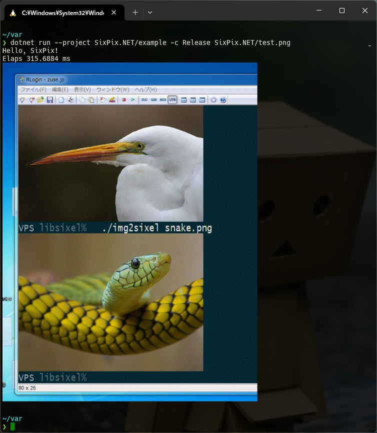

# SixPix.NET
Convert image to Sixel and Sixel to image.

Created with reference to [go-sixel].
And [SixLabors/ImageSharp] is used for image processing.



## :package: NuGet 

[nuget.org] is available.

## Build

```sh
dotnet build -c Debug ./src
```

The project uses ImageSharp 4.x and requires a valid Six Labors license key for building.
See `src/sixlabors.lic` for the community license configuration.

## :bulb: Usage and Example

See [src/README.md](./src/) and [example directory](./example/)

[go-sixel]: https://github.com/mattn/go-sixel
[SixLabors/ImageSharp]: https://github.com/SixLabors/ImageSharp
[nuget.org]: https://www.nuget.org/packages/SixPix/ "NuGet Gallery | SixPix"
